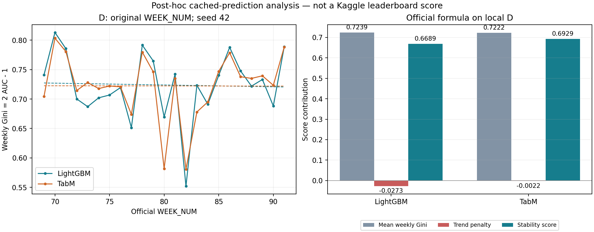

# 按 Home Credit 2024 官方公式的事后评价

这是用户于 2026-10-15 明确要求的固定缓存预测分析。没有训练、重新推理、改选模型/seed、读取 C 标签或提交 Kaggle；原冻结测试评价及暂停状态保持不变。本指标是在看过原始结果后新增的，不能伪装为原先预注册主指标。

## 指标和分组

公式：`mean(weekly_gini) + 88 × min(0, slope) − 0.5 × std(OLS_residuals)`，其中 `weekly_gini = 2 × weekly_ROC_AUC − 1`；周等权、标准差 ddof=0，OLS 横轴为按 WEEK_NUM 排序的周序号。B/D 周号连续，因此使用原 WEEK_NUM 或平移后的序号得到相同斜率和残差。

来源：[官方评价说明](https://www.kaggle.com/competitions/home-credit-credit-risk-model-stability/overview/tracks-and-awards)。
实现约定也对照了[参赛者公布的代码](https://note.erhoeht-x.jp/n/n6079318f58bc)。全部周保留，包括切分边界的不完整周；单类别周会令完整得分未定义，不删除或插值。

原核心报告使用周一开始的自然周，**与原始 WEEK_NUM 分组不同**。本次通过已缓存 train_base.parquet、index_in_full 恢复原周号，逐条核验日期、标签与唯一申请 ID。没有把元数据加入模型；恢复申请 ID 仍不等于验证客户独立性。

- B：40,596 条；2020-01-01—2020-02-29；WEEK_NUM 52—60，9 周；最少每周 3387 条、145 个事件。
- D：56,001 条；2020-05-01—2020-10-05；WEEK_NUM 69—91，23 周；最少每周 270 条、6 个事件。

## 结果解读

D 的 seed=42：LightGBM 得分 0.668858，TabM 得分 0.692867，差值（TabM−LightGBM）为 +0.024009。TabM 的主要优势来自较小的时间下降惩罚（-0.002162，对比 -0.027289），而非更高的平均周 Gini。

全部固定 seed=42/0/1：LightGBM 均值±样本标准差为 0.675912±0.007032；TabM 为 0.665923±0.025336。这三个 seed 中 LightGBM 均值更高且波动更小，不能只选 seed=42 宣称 TabM 稳定胜出。没有对这个新增指标作显著性认证。

同一个 B 上，原始 TabM 为 0.683865，冠军 LGB 特征适配 TabM 为 0.689479，冠军三模型重建融合为 0.686447。冠军 Cat 特征适配 TabM 虽曾取得较高整体 AUC，稳定性得分仅 0.641340，说明新指标会改变对开发方案的评价；本次没有据此重新选模型。

## D：核心模型，seed 42

| model | variant | stability_score | mean_weekly_gini | falling_penalty | variation_penalty |
| --- | --- | --- | --- | --- | --- |
| LightGBM | raw | 0.668858 | 0.723859 | -0.027289 | -0.027712 |
| LightGBM | calibrated | 0.668858 | 0.723859 | -0.027289 | -0.027712 |
| TabM | raw | 0.692867 | 0.722247 | -0.002162 | -0.027218 |
| TabM | calibrated | 0.692867 | 0.722247 | -0.002162 | -0.027218 |
| Constant | raw | 0.000000 | 0.000000 | 0.000000 | -0.000000 |

raw/calibrated 的周 Gini 和最终得分相同是单调校准的预期结果，不能宣称校准提高排序或稳定性得分。



## D：全部匹配 seed

| model | variant | n_seeds | stability_mean | stability_sd |
| --- | --- | --- | --- | --- |
| LightGBM | raw | 3 | 0.675912 | 0.007032 |
| LightGBM | calibrated | 3 | 0.675912 | 0.007032 |
| TabM | raw | 3 | 0.665923 | 0.025336 |
| TabM | calibrated | 3 | 0.665923 | 0.025336 |

这是 42/0/1 三个固定 seed 的均值和样本标准差，不是数据抽样置信区间。周等权会让样本较少的周具有同样权重；23 周单一时间窗口不能证明长期稳定性或统计显著优势。完整逐 seed 和逐周结果分别见 official_metric_D.csv、official_weeks_D.csv。

## B：全部已完成开发方案

| model | variant | stability_score | mean_weekly_gini | falling_penalty | variation_penalty |
| --- | --- | --- | --- | --- | --- |
| LightGBM / original | raw | 0.673157 | 0.684571 | 0.000000 | -0.011414 |
| TabM / original | raw | 0.683865 | 0.691922 | 0.000000 | -0.008057 |
| LightGBM / champion_cat | raw | 0.682722 | 0.690873 | 0.000000 | -0.008152 |
| TabM / champion_cat | raw | 0.641340 | 0.695357 | -0.045957 | -0.008061 |
| LightGBM / champion_lgb | raw | 0.615226 | 0.687727 | -0.063751 | -0.008750 |
| TabM / champion_lgb | raw | 0.689479 | 0.695712 | 0.000000 | -0.006234 |
| LightGBM / tabred_missing | raw | 0.610119 | 0.686740 | -0.067028 | -0.009593 |
| TabM / tabred_missing | raw | 0.684962 | 0.694414 | 0.000000 | -0.009452 |
| Champion reconstruction lgb | raw | 0.591449 | 0.690927 | -0.091532 | -0.007947 |
| Champion reconstruction dense | raw | 0.656458 | 0.665472 | 0.000000 | -0.009014 |
| Champion reconstruction cat | raw | 0.637249 | 0.683780 | -0.037528 | -0.009003 |
| Champion reconstruction blend | raw | 0.686447 | 0.694575 | 0.000000 | -0.008128 |
| Champion reconstruction + score hack (not PD) | fixed_score_hack | 0.644741 | 0.657503 | 0.000000 | -0.012762 |

这些是同一个 B 上的比较，B 只有 9 个官方周，且已被用于 early stopping 和多轮开发，因此不是独立验证。保留固定 score hack 行作为历史诊断，它不代表校准概率；没有调整其参数。ExcelFormer 未完成、S6E7 为 0/28，因此不把它们列为完成模型。

## 能否与 Kaggle 冠军比较

不能把这里的数值换算成榜单名次。我们评的是原比赛公开训练数据经 TabReD 取样后的本地时间留出；Kaggle 排名评的是隐藏测试集，样本、时间跨度、训练量和特征处理均不同。[冠军原文](https://www.kaggle.com/c/home-credit-credit-risk-model-stability/discussion/508337)所述未做 metric hacking 的最高 private 分数约 0.53 仅是背景，不能作为本地 D 的胜负门槛。相同公式不等于相同评测任务。

原版冠军仍缺私有拟合文件和最终列名单。此处“Champion reconstruction”是记录清楚的三模型重建，不是原版冠军精确复现。继承的全量无标签预处理、未知标签期限/成熟时间、未验证客户级独立性等限制仍成立。

## 复现与验证

在本目录用原有 core 虚拟环境执行：

```powershell
& ../../.venv/Scripts/python.exe -m pytest -q -o addopts= --basetemp=.pytest_tmp test_metric.py
& ../../.venv/Scripts/python.exe analyze.py
```

脚本从项目内既有缓存读取，拒绝原始 hash 不匹配；已完成后重跑只核验缓存。需要原本地私有缓存，公开仓库本身不包含行级输入。没有下载或启动模型。

每周 AUC 使用 sklearn 与独立的 Mann–Whitney rank-U 公式交叉计算；OLS 使用 polyfit 与中心化闭式解交叉计算。这是同一 agent 的不同计算路径自查，不是独立外部审计。verification.json 记录重算误差、旧 AUC/AP 一致性、raw/calibrated 一致性及保护文件哈希；RESULT_RECEIPT.json 保留代码、协议、输入和输出身份。
