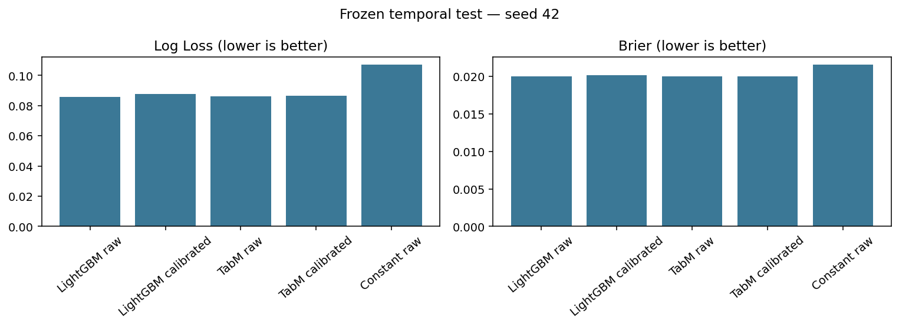
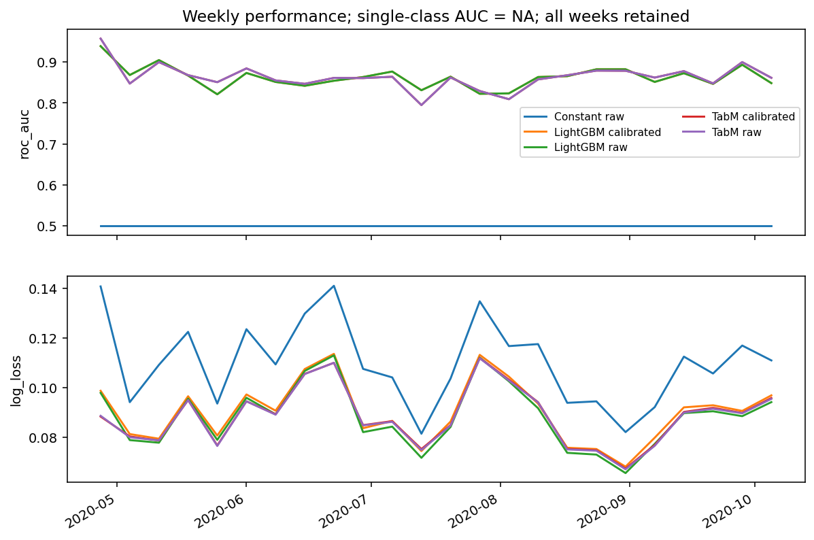
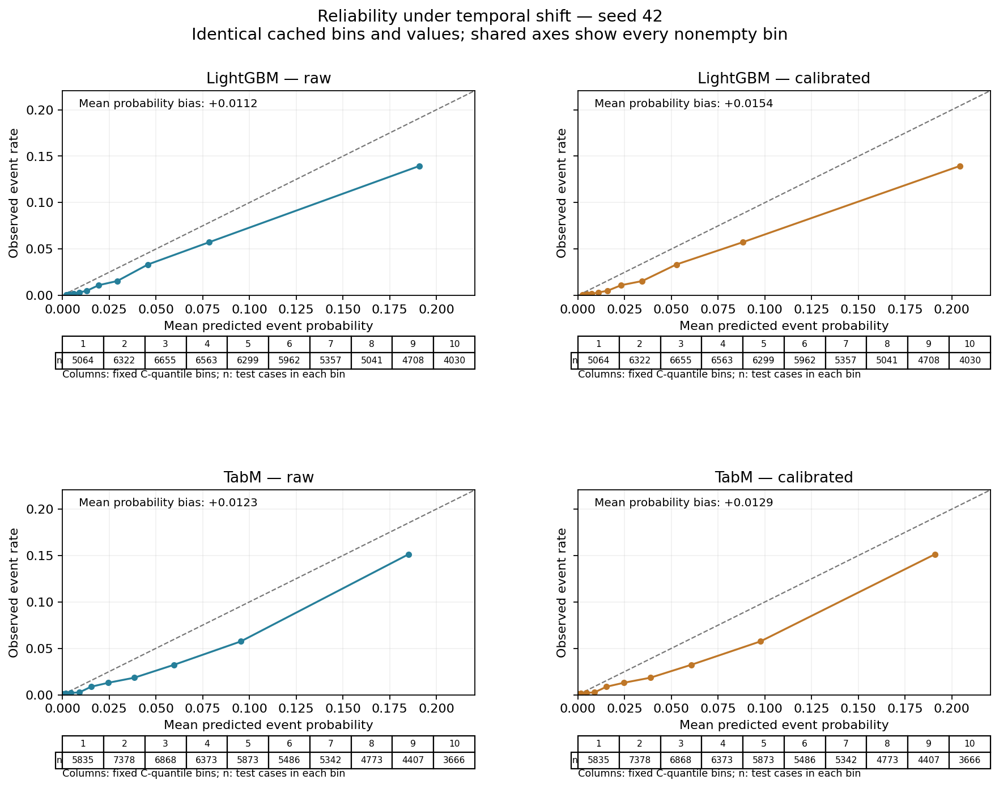
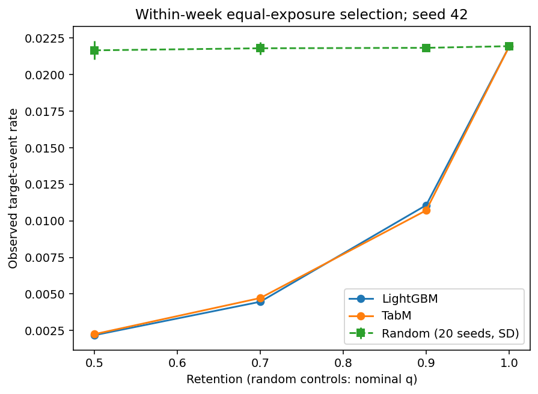
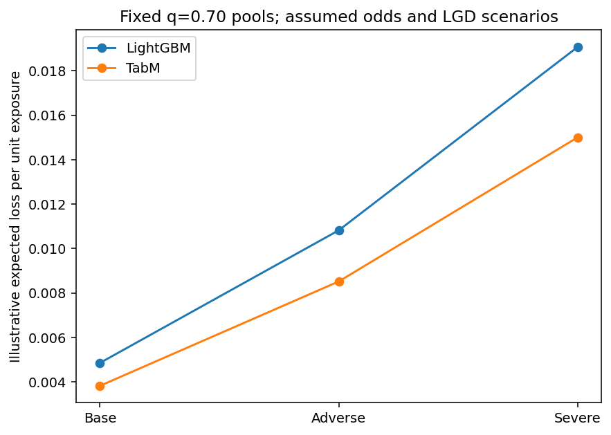
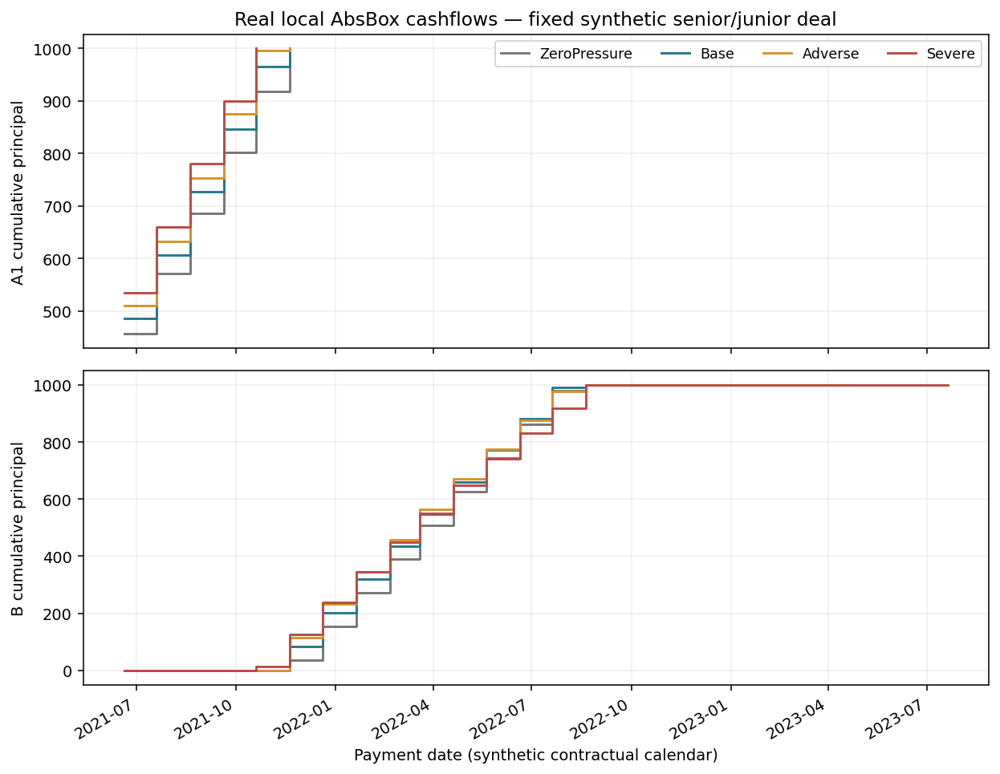

# Credit Risk under Temporal Shift
## Calibrated Default Prediction and Portfolio Stress Analysis

### Questions

This independent public-data project compares LightGBM and official TabM under temporal shift, and asks whether separate-holdout calibration improves later probabilities and loan-pool loss estimates. Status: **CORE_COMPLETE / EXTENSION_COMPLETE**. No private Anoris/JPMorgan data, systems or performance evidence are used. The separate waterfall illustrates mechanics, not an investment strategy.

### Sources and evidence limits

The official authenticated downloader retrieved only TabReD `homecredit-default`, from **Home Credit — Credit Risk Model Stability 2024**, not 2018. The archive hash was verified. Its 381,664 cases and 696 base features are documented in DATA_CARD.md; SOURCE_MANIFEST.json and THIRD_PARTY.md retain file hashes, upstream commits and licenses. Versions: LightGBM 4.6.0, TabM 0.0.3, PyTorch 2.5.1+cu121. Unavailable feature names remain anonymous.

The pinned upstream preprocessing uses full-data missingness, constants, category cardinalities and dtype extrema; its min_frequency=0.01 ordinal encoder precedes temporal splitting. This is an **inherited/transductive preprocessing limitation**, not demonstrated target-label leakage. Exact archive-generation lineage and historical feature availability remain unverified. Training-only re-encoding cannot undo merged categories, so the positioning is a **TabReD-derived temporal benchmark with inherited preprocessing limitations**, not strict point-in-time validation.

The source describes default, but the target horizon, observation window and label maturity cannot be verified. Predictions are dataset target-event probabilities / PD proxies, not one-year PDs. Metadata contain decision-date epoch days and a source-row index, not verified customer identities. Neither enters a model. Customer independence, actual EAD, recoveries, default timing and contractual cashflows are unestablished. No row-level output is published.

### Temporal protocol and computation

| partition | start | end | n |
| --- | --- | --- | --- |
| A | 2019-01-01 | 2019-12-31 | 267645 |
| B | 2020-01-01 | 2020-02-29 | 40596 |
| C | 2020-03-01 | 2020-04-30 | 17422 |
| D | 2020-05-01 | 2020-10-05 | 56001 |

A is official train; B/C divide whole validation dates at their midpoint; D preserves official test indices. All sets are disjoint and time-ordered. This adapts TabReD's protocol. A-only imputation, scaling, vocabularies, constant filtering and bins leave 595 numerical/binary plus 82 categorical inputs; TabM's embedding width is 10,073.

Three frozen candidates per family used seed 42 and B-AUC selection, with log-loss/ID tie-breaks. Selected configurations L3 and T2 were replicated at seeds 0 and 1, without seed selection or external ensembling. Official TabM uses k=32, three width-256 blocks and 32-bin, dimension-16 embeddings. Training averages per-head BCE; inference averages probabilities. No weighting or resampling is used.

The RTX 4080 SUPER ran FP32 TabM with physical/effective batch 256; LightGBM used four CPU threads and native categoricals. 5 LightGBM and 5 TabM fits consumed 2.40/27.77 budget minutes including smoke. Peak RSS/PyTorch allocation: 4.10/1.02 GiB. Equal trial counts are not equal compute; training_summary.csv preserves stopping states.

### Controlled results

The primary table reports seed 42. Constant probability is mean(y_A). Average precision is not relabeled PR-AUC; probability_bias is mean(p) minus mean(y).

| model | variant | roc_auc | average_precision | log_loss | brier | mean_probability | observed_event_rate | probability_bias |
| --- | --- | --- | --- | --- | --- | --- | --- | --- |
| Constant | raw | 0.500000 | 0.021946 | 0.106961 | 0.021542 | 0.030753 | 0.021946 | 0.008807 |
| LightGBM | raw | 0.862234 | 0.166495 | 0.085750 | 0.019990 | 0.033137 | 0.021946 | 0.011191 |
| LightGBM | calibrated | 0.862234 | 0.166495 | 0.087655 | 0.020202 | 0.037305 | 0.021946 | 0.015359 |
| TabM | raw | 0.863624 | 0.170869 | 0.086195 | 0.019971 | 0.034256 | 0.021946 | 0.012310 |
| TabM | calibrated | 0.863624 | 0.170869 | 0.086383 | 0.020013 | 0.034845 | 0.021946 | 0.012899 |

For seed 42, TabM minus LightGBM was +0.001390 in ROC-AUC and +0.000445 in raw log loss. Higher AUC and lower log loss are preferred. Both raw-difference bootstrap intervals span zero: this run does not establish a decisive model advantage.

| model | variant | n | AUC mean ± SD | log loss mean ± SD |
| --- | --- | --- | --- | --- |
| LightGBM | calibrated | 3 | 0.862088 ± 0.000774 | 0.088107 ± 0.000516 |
| LightGBM | raw | 3 | 0.862088 ± 0.000774 | 0.085349 ± 0.000355 |
| TabM | calibrated | 3 | 0.862835 ± 0.001715 | 0.086754 ± 0.001081 |
| TabM | raw | 3 | 0.862835 ± 0.001715 | 0.084874 ± 0.001182 |

The 3 matched seeds [0, 1, 42] describe training variation, not data-sampling uncertainty. Weekly tables retain all 24 calendar batches, including 0 below 100 cases and 0 single-class batches; undefined weekly AUC is NA. The 200 paired two-week moving-block resamples gave a 95% percentile interval of [-0.002761, +0.004918] for raw AUC difference and [-0.000174, +0.001158] for raw log-loss difference (TabM minus LightGBM). These intervals condition on fitted models and short-range time dependence. Unknown customer clusters and longer dependencies remain limitations, and this is not rolling retraining or an executable approval backtest.

### Independent calibration

Each retained model received one positive-slope sigmoid calibrator fitted only on C, after selection and early stopping. Its input is the final model probability; unweighted log loss fits exp(theta) and an intercept under frozen bounds. C fit scores are not generalization results. All model and calibrator hashes were frozen before the single formal D evaluation.

LightGBM: calibrated-minus-raw log loss +0.001905, Brier +0.000212; mean probability bias changed from +0.011191 to +0.015359. At q=0.70, absolute loss-proxy estimation error did not decrease, from 0.002216 to 0.003066 per exposure unit. TabM: calibrated-minus-raw log loss +0.000189, Brier +0.000042; mean probability bias changed from +0.012310 to +0.012899. At q=0.70, absolute loss-proxy estimation error decreased, from 0.001967 to 0.001934 per exposure unit.

Both models' aggregate probability scores and bias worsened; pool-level effects were mixed.

Log loss/Brier changes alone do not establish better calibration. Reliability uses ten C-quantile bins with duplicate boundaries merged and counts shown. Aggregate bias and diagrams provide complementary checks. Positive slope cannot create ranking gains or improve a fixed pool's realized event rate. Raw-probability/stable-ID masks are reused. Four seed-42 TabM inputs were clipped; LightGBM had none.

### Loan pools and illustrative stress

Within every test week, each model keeps floor(q times batch size), with q fixed at 0.50, 0.70, 0.90 and 1.00. The prespecified main q=0.70 retains 39,189 cases at equal exposure. The full-pool event rate is 0.021946; random selection using 20 fixed seeds gives 0.021802 ± 0.000437 at matching weekly counts. Random-run dispersion is not a confidence interval.

| model | variant | n | observed_event_rate | normalized_EL | normalized_observed_proxy | error_per_exposure |
| --- | --- | --- | --- | --- | --- | --- |
| LightGBM | raw | 39189 | 0.004466 | 0.004002 | 0.001786 | 0.002216 |
| LightGBM | calibrated | 39189 | 0.004466 | 0.004852 | 0.001786 | 0.003066 |
| TabM | raw | 39189 | 0.004721 | 0.003856 | 0.001888 | 0.001967 |
| TabM | calibrated | 39189 | 0.004721 | 0.003822 | 0.001888 | 0.001934 |

EAD=1 per row. Expected proxy loss sums P × EAD × LGD; observed proxy loss is **event label × assumed LGD**, not net credit loss or dollars. Comparisons use equal exposure and per-unit rates. Calibration changes estimates, not selected rows or observed events.

| model | scenario | normalized_stress_EL |
| --- | --- | --- |
| LightGBM | Base | 0.004852 |
| LightGBM | Adverse | 0.010821 |
| LightGBM | Severe | 0.019068 |
| TabM | Base | 0.003822 |
| TabM | Adverse | 0.008518 |
| TabM | Severe | 0.015002 |

Base/Adverse/Severe fix odds multipliers 1/1.5/2 and LGDs 0.40/0.60/0.80 on unchanged pools. These assumptions are illustrative, not estimated macroeconomic or regulatory shocks. Formula-driven loss increases are not discoveries, and without matching stress labels there is no stress-period accuracy claim. Returns, Sharpe, LGD estimation, VaR/ES, dependence and tail-loss modeling are outside scope.

### AbsBox status and remaining limits

The actual local AbsBox/Hastructure 0.52.8 engine ran the official synthetic senior/junior example with fixed collateral and waterfall. Home Credit probabilities were never converted to annual CDR or uploaded. Base/Adverse/Severe use annual CDR 2%/5%/10%, annual CPR 5%/10%/15%, recovery 60%/40%/20%, and monthly recovery lags 3/6/9. Annual rates are passed directly to the verified API.

Initial collateral was 2,200 and debt 2,000. In the zero-pressure case and all three scenarios, both tranches repaid 1,000 principal, ended at zero balance, and had zero reported interest shortfall. Cash conservation residuals were 0.00. Small reported default-minus-recovery-minus-loss residuals of 0.15/0.15/0.12 remain unexplained and disclosed; junior interest fields include residual equity distributions. No structure was changed to manufacture senior loss. This is not real CLO valuation or an investment-return backtest.

One formal test receipt fixes predictions and parameters. Tests and same-agent arithmetic checks passed; this is not external validation. Reporting reads cached results; D remains seen.
