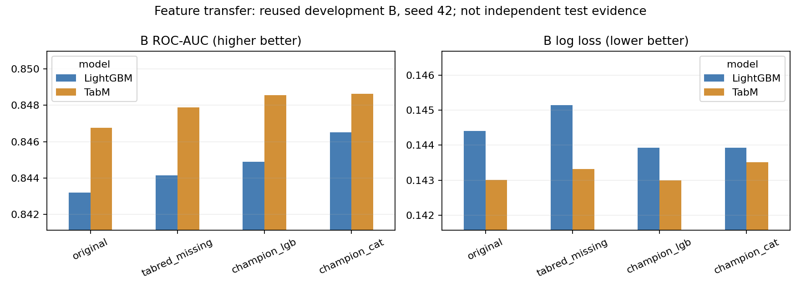

# 冠军特征复现与迁移：实际结果

状态：`MATCHED_TRANSFER_COMPLETE`。完成 6 次新增拟合和两个原始 checkpoint 的 B 复算，共 8 行指标，全部 seed=42。
本轮复现了作者公开特征表达式，并在记录清楚的适配下迁移到现有 TabM 与 LightGBM。
**完整冠军集成尚未复现；本轮没有新增独立测试集结果。**

## 输入如何变成预测

官方 2024 比赛训练表 → 对齐既有 A/B 申请 → 作者的分表聚合 → 相对申请日期 → A-only 过滤、填补、缩放、类别词表及缺失指示 → 固定模型 → B 概率。
TabM 使用官方实现、逐 head BCE 和 sigmoid 后平均概率；它是表格神经网络，**不是 Transformer**。Cat/DNN 指特征来源，没有新增 CatBoost 或 DenseLight 拟合。

对应应用场景：将同一申请的历史金额、还款、税务和类别记录转成水平、极值、波动及信息缺失摘要。
详细机制和经官方字段说明核实的例子见 [特征迁移指南](FEATURE_TRANSFER_GUIDE_ZH.md)。

## 来源与适配

固定作者 `yuuniekiri` 的 LGB kernel **v16** 和 Cat inference kernel **v12**。
复用原始 `Pipeline`、`Aggregator` 和 LGB `agg_by_case`，通过 AST 提取，避免执行顶层模型加载或提交代码。
两个 kernel 都依赖额外拟合模型提供最终列名单；本轮未获取这些模型和最终名单，所以不声称精确复现其 644/661 列、全部训练、集成或冠军分数。
只从官方接口获取 32 份训练 Parquet 和一份特征定义，未下载比赛测试集，未上传数据。
参见 [来源清单](SOURCE_MANIFEST.json)、[署名与限制](THIRD_PARTY.md)、[适配记录](ADAPTATIONS.md)。

为保持对照有效，过滤、填补、词表、缩放、缺失指示及 TabM 分箱均只在 A 拟合。
原始 TabReD 保留全量无标签统计处理的既有限制；raw-derived 表征避免该特定上游类别合并，但并不因此证明 point-in-time 安全。

| 输入表征 | 数值列（不含指示） | 缺失指示列 | 类别列 |
|---|---:|---:|---:|
| 原始 TabReD | 595 | 0 | 82 |
| 原特征 + 缺失标记 | 595 | 536 | 82 |
| 冠军 LGB 特征适配 | 531 | 507 | 74 |
| 冠军 Cat/DNN 特征适配 | 555 | 509 | 102 |

## 固定开发协议

A：2019-01-01—2019-12-31，267,645 条；B：2020-01-01—2020-02-29，40,596 条。
308,241 条申请的映射日期和 A/B 标签与既有基准完全匹配；标识仅证明申请记录匹配，不能证明客户级独立。
新训练严格使用相同 A/B 行，LightGBM 固定 L3，TabM 固定 T2；按 B AUC 保存 checkpoint。
顺序和三种输入在新训练前冻结，没有新增 HPO、seed、重采样或集成。
C 标签未用于这轮实验，旧 D 已在 MVP 中评价过且本轮没有重新评价。
**B 已用于选型和 early stopping，因此这些结果只能回答开发阶段的特征迁移问题。**

## 全部 B 结果

| 输入 | 模型 | ROC-AUC ↑ | AP ↑ | Log loss ↓ | Brier ↓ | 训练状态 |
| --- | --- | --- | --- | --- | --- | --- |
| 原始 TabReD | LightGBM | 0.843209 | 0.234382 | 0.144408 | 0.037682 | REUSED_CHECKPOINT_B_REPLAY |
| 原始 TabReD | TabM | 0.846769 | 0.242141 | 0.143016 | 0.037503 | REUSED_CHECKPOINT_B_REPLAY |
| 原特征 + 缺失标记 | LightGBM | 0.844148 | 0.238455 | 0.145148 | 0.037708 | EARLY_STOPPED |
| 原特征 + 缺失标记 | TabM | 0.847880 | 0.239877 | 0.143319 | 0.037611 | EARLY_STOPPED |
| 冠军 LGB 特征适配 | LightGBM | 0.844886 | 0.246025 | 0.143923 | 0.037464 | EARLY_STOPPED |
| 冠军 LGB 特征适配 | TabM | 0.848547 | 0.244959 | 0.143004 | 0.037525 | EARLY_STOPPED |
| 冠军 Cat/DNN 特征适配 | LightGBM | 0.846518 | 0.236593 | 0.143924 | 0.037639 | EARLY_STOPPED |
| 冠军 Cat/DNN 特征适配 | TabM | 0.848632 | 0.233022 | 0.143517 | 0.037720 | EARLY_STOPPED |

AP 是 average precision。所有预测有限且在 [0,1]。概率均为数据集事件概率 proxy；未做本轮校准。

相对各模型原始输入的变化：

| 新输入 | 模型 | Δ ROC-AUC | Δ log loss |
| --- | --- | --- | --- |
| 原特征 + 缺失标记 | LightGBM | +0.000939 | +0.000740 |
| 原特征 + 缺失标记 | TabM | +0.001111 | +0.000302 |
| 冠军 LGB 特征适配 | LightGBM | +0.001677 | -0.000485 |
| 冠军 LGB 特征适配 | TabM | +0.001778 | -0.000012 |
| 冠军 Cat/DNN 特征适配 | LightGBM | +0.003309 | -0.000484 |
| 冠军 Cat/DNN 特征适配 | TabM | +0.001863 | +0.000501 |

- 原特征 + 缺失标记：TabM 的 B AUC 增加 0.001111，log loss 增加 0.000302。这是此固定 seed 和配置的开发结果。
- 冠军 LGB 特征适配：TabM 的 B AUC 增加 0.001778，log loss 下降 0.000012。这是此固定 seed 和配置的开发结果。
- 冠军 Cat/DNN 特征适配：TabM 的 B AUC 增加 0.001863，log loss 增加 0.000501。这是此固定 seed 和配置的开发结果。

冠军 LGB 特征适配的 TabM AP 变化为 +0.002818，Brier 变化为 +0.000022（Brier 越低越好）。 冠军 Cat/DNN 特征适配的 TabM AP 变化为 -0.009119，Brier 变化为 +0.000217（Brier 越低越好）。
因此不能仅按 AUC 宣称全面提升。Brier 和 log loss 是综合概率评分，不是单独的校准诊断。

相同特征信息下的模型差异（TabM − LightGBM）：

| 输入 | Δ ROC-AUC | Δ log loss |
| --- | --- | --- |
| 原始 TabReD | +0.003560 | -0.001392 |
| 原特征 + 缺失标记 | +0.003732 | -0.001829 |
| 冠军 LGB 特征适配 | +0.003661 | -0.000919 |
| 冠军 Cat/DNN 特征适配 | +0.002113 | -0.000407 |

这些差异没有被包装成“稳健战胜”或独立显著性证据。只跑了一个固定 seed。
较好的 AUC 不自动代表较好的概率质量，也不说明对未来时间段一定有效。
冠军表征是整体替换，包含不同聚合、类别保留和过滤；不能将全部差异归因于某一个统计特征。

## 资源、验证与失败记录

实际设备：NVIDIA GeForce RTX 4080 SUPER, 16376 MiB, 2054 MiB（预检快照），CPU 线程上限 4。
新增模型函数累计计时 23.05 分钟；含进程、分箱等开销的 LightGBM worker 2.84 分钟、TabM worker 21.14 分钟。
从固定源码获取时间到本次报告生成，经过 43.65 分钟；这是包含下载、工程和验证的实际 elapsed，并非纯训练耗时。
未使用付费云资源，没有减少某一模型的样本或特征来完成比较。

| 输入 | 模型 | 模型函数分钟 | 峰值进程 RSS GiB | 峰值 Torch 分配 GiB | 最佳 epoch(0起)/迭代 |
| --- | --- | --- | --- | --- | --- |
| 冠军 Cat/DNN 特征适配 | LightGBM | 0.77 | 3.77 | 0.00 | 406 |
| 冠军 Cat/DNN 特征适配 | TabM | 6.47 | 2.47 | 1.80 | 5 |
| 冠军 LGB 特征适配 | LightGBM | 0.74 | 3.63 | 0.00 | 407 |
| 冠军 LGB 特征适配 | TabM | 6.23 | 2.38 | 1.74 | 5 |
| 原特征 + 缺失标记 | LightGBM | 1.01 | 3.88 | 0.00 | 549 |
| 原特征 + 缺失标记 | TabM | 7.83 | 2.50 | 1.87 | 8 |

- 13 项新增自动化测试通过；预检核验全部输入有限值、类别范围、样本覆盖和元数据排除。
- 另对真实税务表 20 个申请、两套聚合做 220 次 NumPy 算术复算；最大绝对差约 2.3e-13。属于同一实施者的单独复算，不称独立审查，也不覆盖所有表。
- 原始 checkpoint 的 B AUC/log loss 复现到 1e-6 以内；原始冻结代码、模型和结果 hash 保持一致。
- 空分片 UDF、Polars 多分块连接和整数连接键不匹配三次兼容失败均保留日志，修复发生在新训练冻结前。
- 预算或未收敛状态见 `acceptance.json` 和每次 `result.json`，不会把中断训练写成收敛。

## 能借鉴什么，仍不能声称什么

已经可复用的是：按申请聚合多表、分表定义统计表达式、日期差、类别历史和明确缺失编码的工程实现，以及匹配树模型对照的验证方法。
本轮是否改善 TabM 应依据上表逐项判断；某变体无收益仍是保留的结果。
尚不能声称严格 point-in-time、已核实标签成熟、客户级独立、年度 PD、可交易历史回测或完整冠军复现。
该研究不修改原有校准、贷款池或 AbsBox 的冻结结论，也不把开发集变化带入简历的独立测试指标。

复现入口和环境见 [README](README.md)。行级数据、预测及模型保留本地；公开代码的再分发许可证尚未核实。
