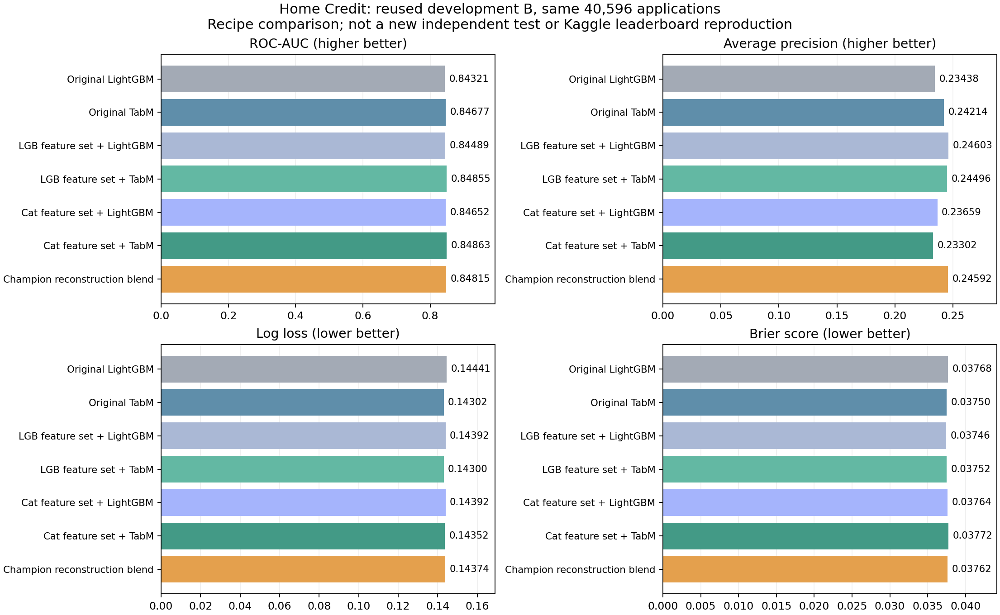
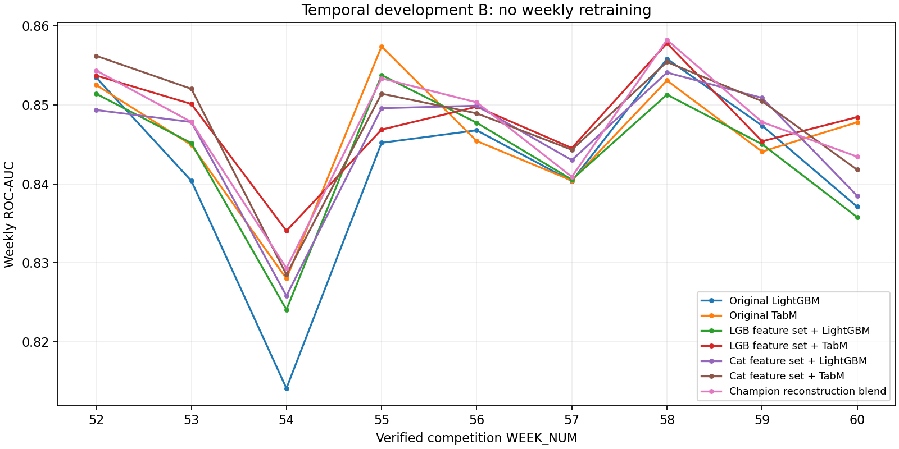

> 已按用户要求暂停：ExcelFormer 训练和后续 S6E7 队列均停止，自动报告更新已关闭。以下为暂停前的历史报告快照；其中 RUNNING / 仍在运行的文字不代表当前状态。当前状态以 PAUSE_RECEIPT.json 和 acceptance.json 为准。

# 完整方案复现与迁移：实际运行状态

更新时间：2026-10-14T22:19:13.949697+00:00

当前总体状态：**REQUEST_RUNNING**。原版冠军：**BLOCKED_DEPENDENCY**；三模型重建版：**THREE_FAMILY_RECONSTRUCTION_COMPLETE**；ExcelFormer 迁移：**RUNNING**；S6E7：**INCOMPLETE**，完成 **0/28** 个 16-epoch 成员。

输入是现有官方 Home Credit 2024 缓存产生的申请记录与历史聚合特征。A 为 2019-01-01 至 2019-12-31，共 267,645 条；B 为 2020-01-01 至 2020-02-29，共 40,596 条。新增运行没有读取 C/D。所有下表结果都是已复用的 B 开发集结果，不能称为新独立测试。

冠军重建版先在 A 内按真实周分成 5 折，各自拟合 LightGBM、CatBoost、官方 DenseLight，再按公开的 0.40/0.36/0.24 权重平均。原作者最终列名单、训练超参数和拟合文件不可得；因此这只是已明确参数的三模型重建。源帖的提前周减 0.03 是比赛分数启发式，其输出另存，不能当作校准后的 PD 或用于贷款损失。

Fraud 仓库的主方案是 ExcelFormer。迁移保留按历史标签块编码类别、训练集 MI 排序及特征混合 BCE；当前数据缺少可验证的客户 UID、银行卡与地址字段，所以没有伪造这些实体特征。初始 16 epoch 后从该阶段最佳模型继续训练，最多再 25 epoch。它按 B 的 AP 选 checkpoint；这与基线的 B-AUC 选型规则不同，不能把差异纯粹归因于网络架构。

S6E7 保留 7 折 × 4 成员、PLR-lite 和折内 exact-value target encoding。内部编码还使用 5 折 cross-fitting，预处理只拟合各外层训练折。三分类源任务迁移为二分类编码/BCE；每个成员固定训练 16 epoch，取最后一轮。原方案的类别先验修正另存为分类诊断，不用于概率评分。未满 28 个成员时不报告为完整 S6E7 结果。

下表保留此前全部固定对照以及已经完成的新结果。没有根据 B 结果追加候选或挑最好 seed。

| name                                          | status                               |   roc_auc |   average_precision |   log_loss |    brier |
|:----------------------------------------------|:-------------------------------------|----------:|--------------------:|-----------:|---------:|
| LightGBM / original                           | REUSED_CHECKPOINT_B_REPLAY           |  0.843209 |            0.234382 |   0.144408 | 0.037682 |
| TabM / original                               | REUSED_CHECKPOINT_B_REPLAY           |  0.846769 |            0.242141 |   0.143016 | 0.037503 |
| LightGBM / champion_cat                       | EARLY_STOPPED                        |  0.846518 |            0.236593 |   0.143924 | 0.037639 |
| TabM / champion_cat                           | EARLY_STOPPED                        |  0.848632 |            0.233022 |   0.143517 | 0.037720 |
| LightGBM / champion_lgb                       | EARLY_STOPPED                        |  0.844886 |            0.246025 |   0.143923 | 0.037464 |
| TabM / champion_lgb                           | EARLY_STOPPED                        |  0.848547 |            0.244959 |   0.143004 | 0.037525 |
| LightGBM / tabred_missing                     | EARLY_STOPPED                        |  0.844148 |            0.238455 |   0.145148 | 0.037708 |
| TabM / tabred_missing                         | EARLY_STOPPED                        |  0.847880 |            0.239877 |   0.143319 | 0.037611 |
| Champion reconstruction lgb                   | THREE_FAMILY_RECONSTRUCTION_COMPLETE |  0.846477 |            0.241895 |   0.143949 | 0.037591 |
| Champion reconstruction dense                 | THREE_FAMILY_RECONSTRUCTION_COMPLETE |  0.833668 |            0.214890 |   0.150877 | 0.038676 |
| Champion reconstruction cat                   | THREE_FAMILY_RECONSTRUCTION_COMPLETE |  0.842748 |            0.239622 |   0.144298 | 0.037592 |
| Champion reconstruction blend                 | THREE_FAMILY_RECONSTRUCTION_COMPLETE |  0.848150 |            0.245916 |   0.143744 | 0.037618 |
| Champion reconstruction + score hack (not PD) | THREE_FAMILY_RECONSTRUCTION_COMPLETE |  0.814947 |            0.239356 |   0.270543 | 0.038022 |

限制：该比较存在开发集重复使用；原上游 TabReD 预处理包含跨切分无标签统计，新增特征筛选也继承之前按 A 拟合的列过滤，A-OOF 不应称为完全独立验证。标签期限、成熟时间和客户级独立性仍不可核实。各方法的特征表达、训练次数、选型规则和算力不同；这是完整配方比较，不是单一架构因果实验。没有将预测概率称为一年期 PD。

来源和依赖阻塞见 `SOURCE_MANIFEST.json`、`CHAMPION_REPRODUCTION_AUDIT.json`、`SOURCE_AUDIT_ADDENDUM.json`、`THIRD_PARTY.md`。各配方的完整性与适配边界见 `REPRODUCTION_BOUNDARIES.md`；冻结设置见 `config.json` 和 `PROTOCOL_LOCK.json`。累计耗时见 `budget.json`；单模型指标、最优轮数、恢复检查点见 `runs/*/receipt.json`。当前图表从本地预测缓存重算，无训练副作用；预算中断的单模型仍保留在表格中，不能冒充完成的配方。

累计分族运行秒数：`{"lgb": 149.95753288269043, "cat": 869.9551527500153, "dense": 147.83326745033264, "excel": 1084.3400461673737}`。该台机器仍在运行时，以 `campaign_state.json` 和各 trial 的 `progress.json` 为准。